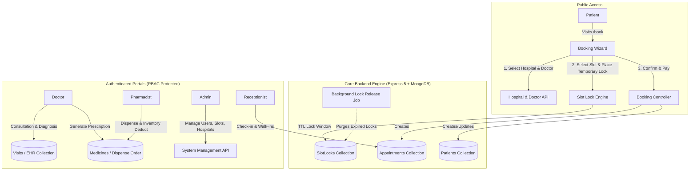

# OpenHMS — Open-Source Hospital & Clinic Management System

<p align="center">
  
  
  
  
  
  
  
</p>

<p align="center">
  <strong>A modern, enterprise-ready, open-source Hospital and Clinic Management Platform (HMS / EHR) built with TypeScript, React 19, Node.js, Express, and MongoDB.</strong>
</p>

<p align="center">
  <a href="#key-features">Key Features</a> •
  <a href="#system-architecture--file-flow">Architecture & Flow</a> •
  <a href="#tech-stack">Tech Stack</a> •
  <a href="#directory-structure">Directory Structure</a> •
  <a href="#getting-started">Getting Started</a> •
  <a href="#api-reference">API Reference</a> •
  <a href="#contributing">Contributing</a> •
  <a href="#license">License</a>
</p>

---

## 📌 Overview

**OpenHMS** is a full-stack, open-source clinic and hospital management solution engineered to streamline healthcare operations. It delivers a self-service public appointment booking engine along with dedicated, role-protected dashboards for **Administrators**, **Doctors**, **Receptionists**, and **Pharmacists**.

Designed to handle real-world clinical traffic, OpenHMS includes an advanced **slot-locking engine** that eliminates race conditions and double bookings during concurrent appointment scheduling.

---

## 🚀 Key Features

### 1. 🌐 Public Patient Booking Engine (`/book/*`)
* **5-Stage Progressive Booking Wizard**:
  1. **Hospital Selection**: Multi-center / multi-branch support with city and location filters.
  2. **Doctor Discovery**: Filter by specialty, consultation fees, and profile.
  3. **Consultation Mode**: In-clinic visit or virtual/online consultation.
  4. **Live Slot Selection with Locking**: Temporary concurrency lock (`SlotLock`) prevents duplicate selections while the patient completes payment.
  5. **Confirmation & Receipt**: Automated appointment token generation and digital booking receipt.

### 2. 🔐 Role-Based Portals (RBAC)
* **Administrator Portal (`/admin`)**:
  * Multi-hospital and branch onboarding.
  * Staff user management (Doctors, Receptionists, Pharmacists, Admins) with secure credential provisioning.
  * Real-time slot management (create, open, close, and configure doctor schedule windows).
  * Lead pipeline tracking and system-wide clinic analytics.
  * Metadata management (diseases, symptoms, treatments, departments).
* **Doctor Portal (`/doctor`)**:
  * Daily appointment queue and patient check-in timeline.
  * Comprehensive Electronic Health Records (EHR) and past patient medical history.
  * Clinical consultation documentation: Chief complaints, diagnosis, vitals, and structured digital prescription generation.
  * Follow-up scheduler and patient search registry.
* **Receptionist Portal (`/receptionist`)**:
  * Front-desk walk-in appointment scheduling and patient check-ins.
  * Real-time doctor availability and queue monitoring.
  * Rapid patient search and registration.
* **Pharmacist Portal (`/pharmacist`)**:
  * Prescription fulfillment queue linked directly to doctor visits.
  * Medicine dispensation tracker with stock adjustments.
  * Drug inventory management, catalog updates, and bulk price/stock updates.

### 3. ⚡ Concurrency & Slot Locking Mechanism
* Avoids double-booking using a stateful slot-window and temporary lock collection.
* Automated background cleanup job (`releaseLocksJob.ts`) that safely purges expired locks after timeout windows.

---

## 🛠 Tech Stack

### Frontend
| Technology | Description |
|---|---|
| **React 19** | Modern UI framework with hooks and functional architecture |
| **Vite 7** | Next-generation frontend tooling and fast HMR bundler |
| **TypeScript 5.9** | Static type checking and strict interface safety |
| **Tailwind CSS 4** | Utility-first responsive design framework |
| **Radix UI** | Accessible, unstyled UI primitives (Dialog, Tabs, Accordion, Popover, Select, Avatar) |
| **React Hook Form + Zod** | Form validation with schema declaration |
| **React Router v7** | Client-side routing with role-based protected routes |
| **Lucide React** | Consistent, modern vector iconography |
| **Axios** | HTTP client with credential support and fallback mock toggles |
| **React Hot Toast** | Lightweight toast notifications |

### Backend
| Technology | Description |
|---|---|
| **Node.js** | Server runtime environment |
| **Express 5** | RESTful API server framework |
| **TypeScript** | Type-safe controllers, services, and middlewares |
| **MongoDB & Mongoose 9** | NoSQL document database with typed schemas |
| **JWT (jsonwebtoken)** | Secure authentication tokens |
| **BcryptJS** | Salted cryptographic password hashing |
| **Cookie-Parser & CORS** | Cookie-based session storage and origin control |
| **NanoID / UUID** | Unique reference and token generation |

### Utility & Database Seeding
| Tool | Description |
|---|---|
| **Python 3** | Automated mock seed generation script (`generate_seed.py`) |
| **JSON Seed Sets** | Pre-generated dummy datasets (`database_seed/patients.json`, `database_seed/visits.json`) |

---

## 🔄 System Architecture & Data Flow



---

## 📁 Directory Structure

```text
├── backend/                       # Node.js + Express 5 Backend
│   ├── src/
│   │   ├── config/                # Environment variables, constants & MongoDB connection
│   │   │   ├── constants.ts
│   │   │   ├── db.ts              # Mongoose connection logic
│   │   │   └── env.ts             # Process env validation & defaults
│   │   ├── controllers/           # HTTP Request & Response handlers
│   │   │   ├── analyticsController.ts
│   │   │   ├── appointmentController.ts
│   │   │   ├── bookingController.ts
│   │   │   ├── hospitalController.ts
│   │   │   ├── leadController.ts
│   │   │   ├── metadataController.ts
│   │   │   ├── patientController.ts
│   │   │   ├── pharmacistController.ts
│   │   │   ├── slotController.ts
│   │   │   ├── userController.ts
│   │   │   └── visitController.ts
│   │   ├── jobs/                  # Background worker tasks
│   │   │   └── releaseLocksJob.ts # Auto-release expired slot locks
│   │   ├── middlewares/           # Authentication, RBAC & error handling
│   │   │   ├── authMiddleware.ts  # JWT verification
│   │   │   ├── roleMiddleware.ts  # Role guard (admin, doctor, etc.)
│   │   │   ├── rateLimiter.ts
│   │   │   ├── validateBody.ts
│   │   │   └── errorMiddleware.ts
│   │   ├── models/                # Mongoose Schema Definitions
│   │   │   ├── Appointment.ts
│   │   │   ├── Hospital.ts
│   │   │   ├── Lead.ts
│   │   │   ├── Medicine.ts
│   │   │   ├── Metadata.ts
│   │   │   ├── Patient.ts
│   │   │   ├── SlotLock.ts
│   │   │   ├── SlotWindow.ts
│   │   │   ├── Token.ts
│   │   │   ├── User.ts
│   │   │   └── Visit.ts
│   │   ├── routes/                # Modular Express Route Definitions
│   │   │   ├── analyticsRoutes.ts
│   │   │   ├── appointmentRoutes.ts
│   │   │   ├── bookingRoutes.ts
│   │   │   ├── hospitalRoutes.ts
│   │   │   ├── leadRoutes.ts
│   │   │   ├── metadataRoutes.ts
│   │   │   ├── patientRoutes.ts
│   │   │   ├── pharmacistRoutes.ts
│   │   │   ├── slotRoutes.ts
│   │   │   ├── userRoutes.ts
│   │   │   └── visitRoutes.ts
│   │   ├── services/              # Pure Business Logic Layer
│   │   ├── utils/                 # Password hashing, JWT, time helpers, nanoid
│   │   ├── app.ts                 # Express application instantiation & route mounts
│   │   └── server.ts              # Server lifecycle entry point
│   ├── package.json
│   └── tsconfig.json
│
├── database_seed/                 # Sample Seed Data
│   ├── patients.json              # Mock patient records
│   └── visits.json                # Mock clinical consultation visits
│
├── src/                           # React 19 Frontend
│   ├── components/                # Reusable UI & Layout components
│   │   ├── auth/                  # ProtectedRoute & Auth Guards
│   │   └── ui/                    # Radix & Tailwind UI primitives
│   ├── context/                   # React Context (AuthContext, etc.)
│   ├── pages/                     # Role-based dashboard interfaces
│   │   ├── admin/                 # Administrator dashboards & management tabs
│   │   ├── auth/                  # Login & Signup pages
│   │   ├── doctor/                # Doctor consultation, history & visits
│   │   ├── pharmacist/            # Medicine stock, dispensation & updates
│   │   └── receptionist/          # Appointments desk & check-in
│   ├── patientBookingApp/         # Self-contained public booking wizard
│   │   ├── BookingApp.tsx
│   │   └── components/            # Step-by-step wizard components
│   ├── routes/                    # Frontend client routes (AppRoutes.tsx)
│   ├── services/                  # Axios API connectors & fallback mock datasets
│   ├── App.tsx                    # React root component with routing & toast providers
│   └── main.tsx                   # DOM mounting point
│
├── generate_seed.py               # Python utility to generate random clinic seed data
├── index.html                     # HTML root template
├── package.json                   # Frontend dependencies
├── tailwind.config.js             # Tailwind CSS configuration
└── vite.config.ts                 # Vite setup
```

---

## 🚦 Getting Started

### Prerequisites
* **Node.js**: v18.0.0 or higher (v20+ recommended)
* **npm** or **pnpm** / **yarn**
* **MongoDB**: Local MongoDB instance or MongoDB Atlas cluster URI
* **Python 3** (Optional): If you wish to run the database seed generator

---

### 1. Clone the Repository
```bash
git clone https://github.com/sagarsinha668/OpenHMS.git
cd OpenHMS
```

---

### 2. Backend Setup

1. Navigate to the backend directory:
   ```bash
   cd backend
   npm install
   ```

2. Create an environment file `.env` in the `backend/` folder:
   ```env
   # Server Port
   PORT=3000
   NODE_ENV=development

   # Database Connection
   MONGODB_URI=mongodb://localhost:27017/openhms

   # Authentication Secret
   JWT_SECRET=your_super_secret_jwt_key_here
   JWT_EXPIRES_IN=24h
   ```

3. Start the backend in development mode:
   ```bash
   npm run dev
   ```
   The backend API will be available at: `http://localhost:3000`

---

### 3. Frontend Setup

1. Open a new terminal and navigate to the project root:
   ```bash
   cd ..
   npm install
   ```

2. Create an environment file `.env` in the root folder:
   ```env
   VITE_API_URL=http://localhost:3000/api
   ```

3. Launch the Vite development server:
   ```bash
   npm run dev
   ```
   Open your browser at `http://localhost:5173`.

---

### 4. Seeding Test Data (Optional)

You can generate mock patients, hospitals, and visit history using the included generator:

```bash
# Run python seed generator to produce mock JSON datasets
python generate_seed.py

# Import into MongoDB (using mongoimport)
mongoimport --uri="mongodb://localhost:27017/openhms" --collection=patients --file=database_seed/patients.json --jsonArray
mongoimport --uri="mongodb://localhost:27017/openhms" --collection=visits --file=database_seed/visits.json --jsonArray
```

---

## 📡 API Reference Overview

The backend exposes structured RESTful endpoints under `/api`:

| Base Endpoint | Role / Auth | Description |
|---|---|---|
| `POST /api/users/login` | Public | Authenticates user and issues HTTP-only JWT cookie |
| `POST /api/users/register` | Public / Admin | Registers new staff or user credentials |
| `GET /api/users` | Admin | Fetches paginated staff users |
| `GET /api/hospitals` | Public / Authenticated | Lists all registered hospitals/clinics |
| `POST /api/hospitals` | Admin | Registers a new clinic or hospital branch |
| `GET /api/slots` | Public / Authenticated | Retrieves available time slots for doctors |
| `POST /api/slots` | Admin / Doctor | Configures and generates doctor time-slot windows |
| `POST /api/public/booking` | Public | Patient booking endpoint with slot-lock validation |
| `GET /api/patients` | Doctor / Receptionist | Retrieves patient records and history |
| `POST /api/patients` | Doctor / Receptionist | Creates a new patient profile |
| `GET /api/visits` | Doctor / Admin | Electronic health records and consultation logs |
| `POST /api/visits` | Doctor | Records a patient visit, diagnosis, and prescription |
| `GET /api/pharmacist/medicines` | Pharmacist / Admin | Fetches medicine inventory |
| `PUT /api/pharmacist/dispense` | Pharmacist | Marks prescriptions as fulfilled and updates stock |
| `GET /api/analytics` | Admin | Clinic performance metrics and appointment statistics |

---

## 🔒 Security & Best Practices

* **HTTP-Only Cookies**: Prevents client-side script access to JWT tokens, mitigating XSS attacks.
* **Role-Based Guards**: Every private endpoint is validated through `authMiddleware` and `roleMiddleware`.
* **Atomic Slot Reservation**: Concurrency control prevents slot collision in high-demand environments.
* **Input Sanitization**: Request payloads are validated before reaching the service layer.

---

## 🤝 Contributing

Contributions make the open-source community an incredible place to learn, inspire, and create. Any contributions you make are **greatly appreciated**.

1. Fork the Project.
2. Create your Feature Branch:
   ```bash
   git checkout -b feature/AmazingFeature
   ```
3. Commit your Changes:
   ```bash
   git commit -m 'Add some AmazingFeature'
   ```
4. Push to the Branch:
   ```bash
   git push origin feature/AmazingFeature
   ```
5. Open a **Pull Request**.

---

## 📜 License

Distributed under the **MIT License**. See `LICENSE` for more information.

---

<p align="center">
  Built with ❤️ for the global open-source healthcare community.
</p>
